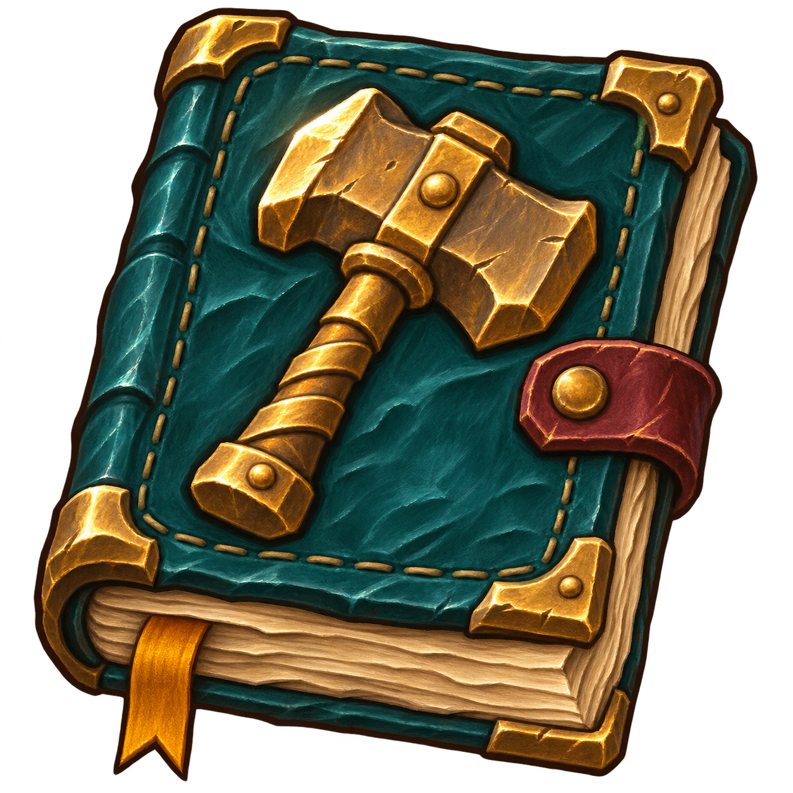

# Craftbound



Profession levelling for **WoW: Forever**. Craftbound puts the next step in your profession
window, buys what the route still needs in the auction house, and remembers where every
character stopped.

**Docs: https://antnsn.github.io/Craftbound/**

- The panel beside the profession window shows the current step, the recipe already selected,
  and a **Craft** button that crafts what the step still needs.
- The panel beside the auction house shows what the rest of the route needs minus your bags and
  bank. **Buy next** scans prices and buys at the server's price after you confirm.
- Progress is saved per character, with a tracker that says what comes next.
- Guides: Enchanting, Alchemy, Blacksmithing, Engineering, Leatherworking, Tailoring, Cooking and First Aid, 1-300: Wowhead's "Tried & Tested in Forever" routes.

`/craft` opens the Craftbound window: every guide, where to stop (150, 225, 300) and what it costs, and your own guides to make and share. `/craft help` lists the commands.

## Development

No build step: WoW loads the .lua files directly. From this folder:

```bash
python3 -I tools/import_wowhead.py                # Wowhead's Forever routes (tools/data/wh_*.json) into the JSON
python3 tools/build_guides.py                     # Guides.lua from tools/data/profession-guides.json
for f in *.lua; do luac5.1 -p "$f"; done
~/.luarocks/bin/luacheck .
wowbench check . && wowbench test .               # 0 errors, every scenario ok
```

Scenarios live in `tests/*.scenario.lua`. `tests/_helper.lua` has fake versions of
`C_TradeSkillUI` and `C_AuctionHouse`, because the wowbench stand-in client doesn't model them.

## License

GPL-3.0-or-later (see `LICENSE`). Trainer and vendor places come from QuestieDB, part of [Questie](https://github.com/Questie/Questie), used under the GPLv3.
